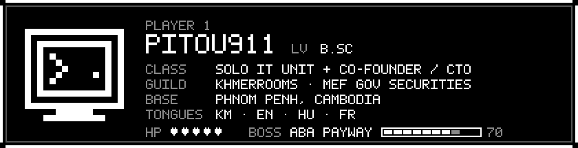
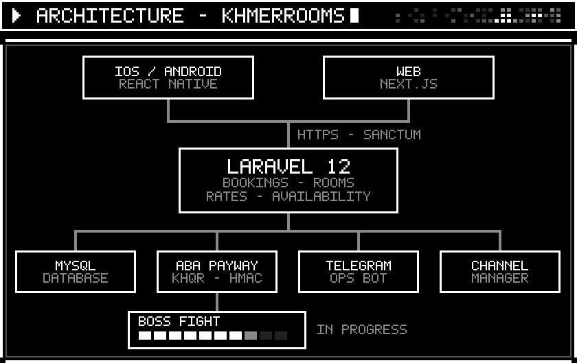
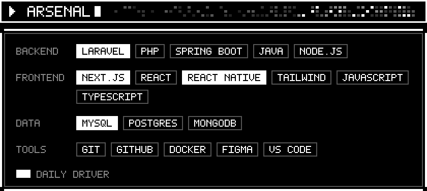

<div align="center">



<a href="https://git.io/typing-svg">

</a>

<br/>


<br/><br/>



</div>

<br/>


> Not a skills list. These are systems that are running right now, and I'm the one who gets called when they stop.

| | SYSTEM | ROLE | STACK | STATE |
|:--|:--|:--|:--|:--|
| `█` | **KhmerRooms** — Cambodia-first hotel OTA · [khmerrooms.com](https://khmerrooms.com) | Co-Founder / CTO | `Next.js` `React Native` `Laravel 12` | `▓▓▓▓▓` **SHIPPED** |
| `█` | **Government Securities Platform** — internal, MEF | Sole engineer | `Laravel 12` `MySQL` | `▓▓▓▓▓` **LIVE · INTERNAL** |
| `█` | **Saravoan Medical Laboratory** · [eltech.duckdns.org](https://eltech.duckdns.org/) | Freelance build | `React 18` `Laravel 11` `FrankenPHP` | `▓▓▓▓▓` **SHIPPED** |
| `░` | **SwiftPOS** — retail point-of-sale | Solo | `Laravel 12` `Alpine.js` `Tailwind` | [`repo ▸`](https://github.com/Pitou911/POS-Laravel) |
| `░` | **Immutable Audit Trail** — SHA-256 hash chain | Solo | `Laravel` `MySQL` | [`repo ▸`](https://github.com/Pitou911) |
| `░` | **CareNest** — symptom → disease prediction | AI engineer, team of 4 | `Spring Boot` `Flask` `scikit-learn` | [`repo ▸`](https://github.com/Pitou911/CareNest-AI-Disease-Prediction-App) |

<sub>`█` in production · `░` archived or open source</sub>

<br/>



```
   ▄▄▄▄▄▄▄▄▄▄▄▄▄▄▄▄▄▄▄▄           ▄▄▄▄▄▄▄▄▄▄▄▄▄▄▄▄▄▄▄▄
   █  iOS / Android   █           █       Web        █
   █  React Native    █           █     Next.js      █
   ▀▀▀▀▀▀▀▀▀█▀▀▀▀▀▀▀▀▀▀           ▀▀▀▀▀▀▀▀▀█▀▀▀▀▀▀▀▀▀▀
            █▄▄▄▄▄▄▄▄▄▄▄▄▄▄▄█▄▄▄▄▄▄▄▄▄▄▄▄▄▄█
                            █  HTTPS · Sanctum
                 ▄▄▄▄▄▄▄▄▄▄▄█▄▄▄▄▄▄▄▄▄▄▄▄
                 █      LARAVEL 12      █
                 █  bookings · rooms ·  █
                 █ rates · availability █
                 ▀▀▀▀▀▀▀▀▀▀▀█▀▀▀▀▀▀▀▀▀▀▀▀
        █▄▄▄▄▄▄▄▄▄▄▄▄▄▄█▄▄▄▄█▄▄▄▄▄▄▄▄█▄▄▄▄▄▄▄▄▄▄▄▄▄▄█
   ▄▄▄▄▄█▄▄▄▄   ▄▄▄▄▄▄▄█▄▄▄▄▄   ▄▄▄▄▄█▄▄▄▄▄▄   ▄▄▄▄▄█▄▄▄▄▄▄
   █  MySQL █   █ ABA PayWay█   █ Telegram █   █ Channel  █
   █        █   █ KHQR·HMAC █   █ ops bot  █   █ manager  █
   ▀▀▀▀▀▀▀▀▀▀   ▀▀▀▀▀▀▀█▀▀▀▀▀   ▀▀▀▀▀▀▀▀▀▀▀▀   ▀▀▀▀▀▀▀▀▀▀▀▀
                       █
               ▄▄▄▄▄▄▄▄█▄▄▄▄▄▄▄▄
               █  ☠ BOSS FIGHT █   HP ▓▓▓▓▓▓▓░░░  in progress
               ▀▀▀▀▀▀▀▀▀▀▀▀▀▀▀▀▀
```

<br/>



<div align="center">
<br/>


<br/>


</div>

<br/>


<details>
<summary><code>▸ cat /etc/identity</code></summary>

<br/>

```yaml
name:      Song Pitou
alias:     Pitou911  ·  "twin"
base:      Phnom Penh, Cambodia
degree:    B.Sc. Computer Engineering
           University of Debrecen, Hungary  (2022–2026)
           Stipendium Hungaricum scholarship
day_job:   the entire IT department of one government department
night_job: co-founding an OTA that speaks Khmer first
creed:     Systems first. Code second. Ship always.
```

</details>

<details>
<summary><code>▸ locale -a</code></summary>

<br/>

```
km_KH   ភាសាខ្មែរ     ▓▓▓▓▓   native
en_US   English      ▓▓▓▓░   fluent
hu_HU   Magyar       ▓▓▓░░   four years in Debrecen will do that
fr_FR   Français     ▓▓░░░   school, and it stuck
```

Four languages, one keyboard layout that still fights me.

</details>

<details open>
<summary><code>▸ tail -f /var/log/quests.log</code></summary>

<br/>

```log
[MAIN QUEST]  ABA PayWay + KHQR integration — HMAC-SHA512 verification
[MAIN QUEST]  Hotel onboarding flow for KhmerRooms partners
[MAIN QUEST]  Central Data Hub feasibility work for MEF
[LEVEL UP ]  Getting better at system design under real load
[SIDE QUEST]  A roguelite in Unity that I swear I will finish
```

</details>

<details>
<summary><code>▸ uptime --offline</code></summary>

<br/>

Away from the terminal I'm on a trail somewhere, reading science fiction, or drawing things one pixel at a time. I build small, useless, beautiful software as gifts. It's the best debugging there is.

</details>

<br/>


<div align="center">
<br/>


<br/>


<br/>


</div>

<br/>


<div align="center">
<br/>

<a href="https://khmerrooms.com">

</a>
<a href="https://www.linkedin.com/in/song-pitou-414834216/">

</a>
<a href="mailto:songpitou723@gmail.com">

</a>

<br/><br/>



</div>
